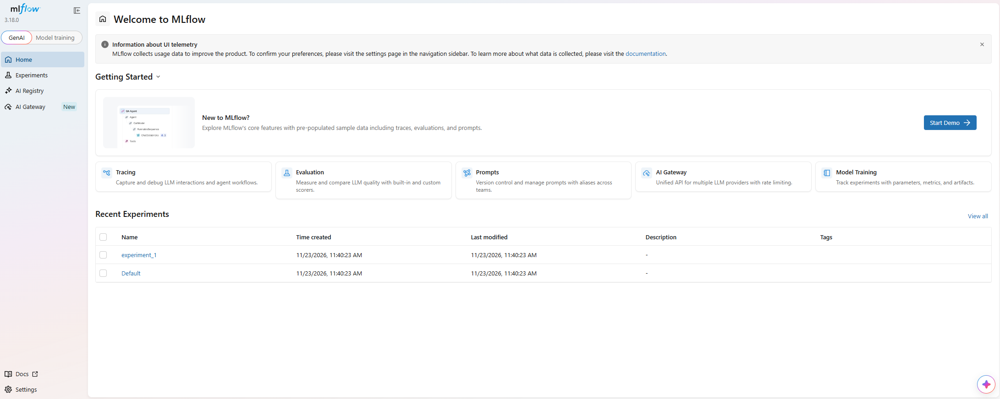
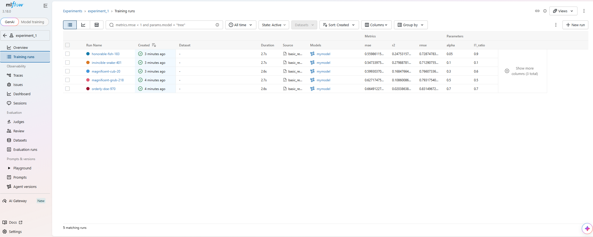
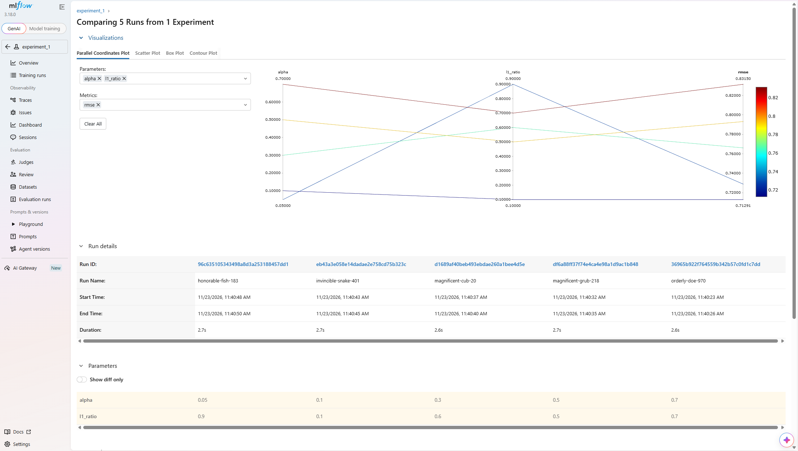
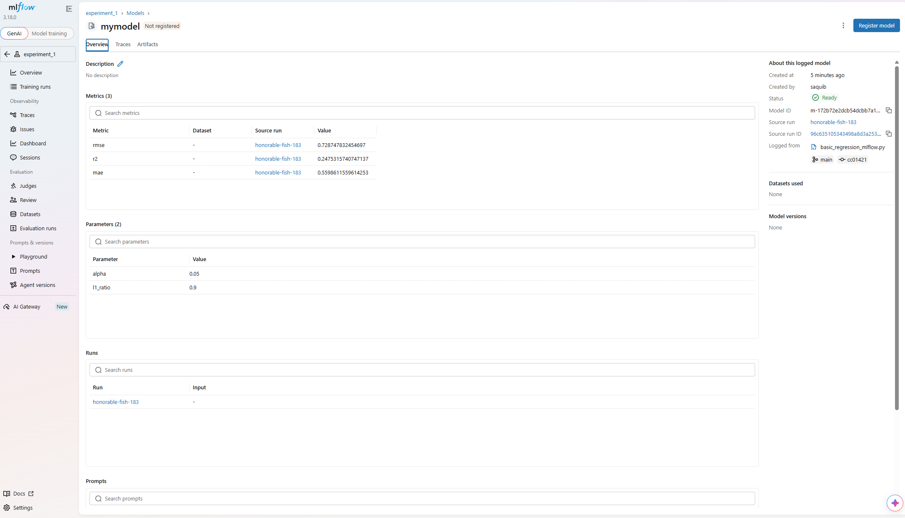
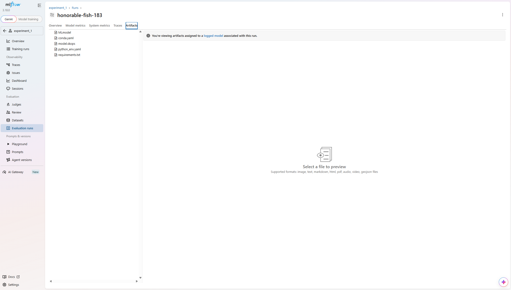

# MLOps with MLflow

My notes and code from a Udemy course on MLflow. Every lesson has its own folder of runnable examples under [`examples/`](./examples/), and this README holds the notes for each lesson, numbered in course order.

All examples train the same **ElasticNet regression** model to predict red wine quality ([`data/red-wine-quality.csv`](./data/red-wine-quality.csv)), so you can compare the MLflow features themselves without the ML code changing.

## Overview

- [1. Introduction to MLOps](#1-introduction-to-mlops)
- [2. Introduction to MLflow](#2-introduction-to-mlflow)
  - [Components](#components)
  - [Setup](#setup)
- [3. MLflow Tracking Component](#3-mlflow-tracking-component)
  - [Basic Tracking - 01_tracking](#basic-tracking---01_tracking)
  - [MLflow UI - 01_tracking](#mlflow-ui---01_tracking)
- [4. MLflow Logging Functions](#4-mlflow-logging-functions)
  - [Get and Set Tracking URI - 02_logging](#get-and-set-tracking-uri---02_logging)
  - [Experiment: Creating and Setting - 02_logging](#experiment-creating-and-setting---02_logging)
- [Notes on MLflow 3.x](#notes-on-mlflow-3x)
- [Changelog](#changelog)
- [Useful Links](#useful-links)

More sections will be added as the course goes on.

## 1. Introduction to MLOps

**MLOps** applies DevOps practices to machine learning, so that models can be built, deployed and maintained reliably. It matters because an ML system is more than its code. Its behavior also depends on:

- **Data:** the data it was trained on, which changes over time.
- **Configuration:** hyperparameters, features and preprocessing.
- **Environment:** library versions, hardware and runtime.

Typical problems that MLOps addresses:

- "Which hyperparameters gave the best model last week?" → experiment **tracking**
- "Can I re-run this training and get the same result?" → **reproducibility** (code, data and environment versioned together)
- "Which model is in production, and which one replaces it?" → model **registry** and versioning
- "How do I serve this model and know when it degrades?" → **deployment** and **monitoring**

The ML lifecycle in short: data collection → data preparation → training and experimentation → evaluation → deployment → monitoring → retraining (back to the start).

## 2. Introduction to MLflow

MLflow is an open-source platform for managing the ML lifecycle. It doesn't depend on any particular library (scikit-learn, PyTorch, XGBoost and others all work with it) and runs locally, on a server or in managed services.

### Components

| Component | What it does |
|---|---|
| **Tracking** | Records runs: parameters, metrics, tags, artifacts and models. Includes a UI to compare runs. |
| **Models** | A standard format for packaging models ("flavors"), so they can be loaded and served the same way. |
| **Model Registry** | A central store of model versions, with aliases and stages (for example staging or production). |
| **Projects** | Packages code with its environment (`MLproject` file) so others can run it the same way. |
| **Evaluation** | Built-in and custom metrics to evaluate and compare models. |

### Setup

The project uses [uv](https://docs.astral.sh/uv/) to manage Python and dependencies.

```bash
git clone https://github.com/saquibherman/mlops-with-mlflow.git
cd mlops-with-mlflow
uv sync          # creates .venv/ with the exact versions from uv.lock
```

Main packages: `mlflow`, `scikit-learn`, `pandas`, `numpy` (see [`pyproject.toml`](./pyproject.toml)). A plain [`requirements.txt`](./requirements.txt) is kept for installs that don't use uv.

**Repository layout:**

```
mlops-with-mlflow/
├── assets/                       # screenshots used in these notes
├── data/
│   └── red-wine-quality.csv      # dataset shared by all lessons
├── examples/
│   ├── 01_tracking/              # 3. MLflow Tracking Component
│   └── 02_logging/               # 4. MLflow Logging Functions
├── pyproject.toml / uv.lock      # dependencies
└── README.md                     # these notes
```

**Dataset:** 1,599 red wines with 11 physico-chemical features (acidity, sugar, alcohol and so on) and a `quality` score (3–8 in this file). The CSV also starts with an unnamed index column, and the examples currently use it as a feature, the same way the course code does.

**Running an example:** always `cd` into the lesson folder first. MLflow writes `mlruns/`, `mlflow.db` and `myartifacts/` into the folder the script is run from, so each lesson keeps its own tracking data. These folders are in `.gitignore`.

```bash
cd examples/01_tracking
uv run basic_regression_mlflow.py --alpha 0.5 --l1_ratio 0.3
```

Every example takes the same two hyperparameters:

| Argument | Default | Meaning |
|---|---|---|
| `--alpha` | `0.7` | Overall regularization strength |
| `--l1_ratio` | `0.7` | Mix of L1 vs L2 penalty (0 = ridge, 1 = lasso) |

## 3. MLflow Tracking Component

The tracking component answers the question "what did I try, and how well did it work?" It is organized as follows:

- An **experiment** groups related runs, for example everything for the wine-quality model.
- A **run** is one execution of the training code. It stores:
  - **parameters:** inputs such as `alpha` and `l1_ratio`;
  - **metrics:** numeric results such as `rmse`, which can be logged many times per run;
  - **tags:** free-form labels;
  - **artifacts:** files, including the trained model itself.

### Basic Tracking - 01_tracking

File: [`examples/01_tracking/basic_regression_mlflow.py`](./examples/01_tracking/basic_regression_mlflow.py)

The script trains the model and records everything inside a run:

```python
exp = mlflow.set_experiment(experiment_name="experiment_1")

with mlflow.start_run(experiment_id=exp.experiment_id):
    lr = ElasticNet(alpha=alpha, l1_ratio=l1_ratio, random_state=42)
    lr.fit(train_x, train_y)
    (rmse, mae, r2) = eval_metrics(test_y, lr.predict(test_x))

    mlflow.log_param("alpha", alpha)          # inputs
    mlflow.log_param("l1_ratio", l1_ratio)
    mlflow.log_metric("rmse", rmse)           # results
    mlflow.log_metric("r2", r2)
    mlflow.log_metric("mae", mae)
    mlflow.sklearn.log_model(lr, "mymodel")   # the trained model as an artifact
```

How it works:
- `set_experiment` picks the experiment the runs go into, and creates it if it doesn't exist.
- `start_run` is a context manager. The run ends, and is marked finished, when the `with` block exits.
- `mlflow.sklearn.log_model` saves the model in MLflow's format. This includes an `MLmodel` descriptor, the serialized model and the environment files (`conda.yaml`, `python_env.yaml`, `requirements.txt`), so the model can be reloaded or served later.
- No tracking URI is set, so MLflow 3.x uses its default: a SQLite database `mlflow.db` in the current folder.

**Try it:** run the script several times with different hyperparameters, then compare the runs in the UI:

```bash
cd examples/01_tracking
uv run basic_regression_mlflow.py --alpha 0.7 --l1_ratio 0.7
uv run basic_regression_mlflow.py --alpha 0.3 --l1_ratio 0.5
uv run basic_regression_mlflow.py --alpha 0.1 --l1_ratio 0.1
```

Example output with the defaults:

```
Elasticnet model (alpha=0.700000, l1_ratio=0.700000):
  RMSE: 0.831496722394997
  MAE: 0.6649122711693408
  R2: 0.020386384678371283
```

### MLflow UI - 01_tracking

Start the UI from the lesson folder, pointing it at the same backend the script wrote to:

```bash
cd examples/01_tracking
uv run mlflow ui --backend-store-uri sqlite:///mlflow.db
# open http://127.0.0.1:5000
```

The screenshots below come from MLflow 3.18, after five runs of `basic_regression_mlflow.py` with different `alpha` / `l1_ratio` values.

**Home page.** The left sidebar leads to **Experiments**. *Recent Experiments* lists `experiment_1` and the `Default` experiment that MLflow always creates. MLflow 3.x also shows GenAI features (tracing, prompts, AI Gateway), which this course doesn't use yet.



**Training runs.** Open `experiment_1` → **Training runs** for one row per run. Each run gets a random name (for example `honorable-fish-183`), and the table shows its duration, source script, logged model (`mymodel`), metrics (`mae`, `r2`, `rmse`) and parameters (`alpha`, `l1_ratio`). Click a column to sort, or filter runs with the search box, for example `metrics.rmse < 0.75 and params.alpha = "0.1"`.



**Comparing runs.** Tick two or more runs and click **Compare**. The **Parallel Coordinates Plot** draws one line per run across `alpha` → `l1_ratio` → `rmse`, colored by `rmse`. Here the lowest error (≈0.713) comes from small `alpha` (weak regularization), and the highest (≈0.831) from `alpha = 0.7`. The page also has Scatter, Box and Contour plots, plus side-by-side tables of run details and parameters.



**Logged model.** In MLflow 3.x, `log_model` creates a **logged model**, a first-class object with its own page and an ID like `m-...`. The page shows the model's metrics and parameters, its source run, the script it was logged from, and the **git branch and commit** of that code. That last part records which code version produced the model, which helps reproducibility. **Register model** sends it to the Model Registry, covered in a later section.



**Run artifacts.** A run's **Artifacts** tab lists the files `log_model` saved:
- `MLmodel`: the descriptor (flavors, how to load the model, signature);
- `model.skops`: the serialized scikit-learn model (`skops` is a safer format than pickle);
- `conda.yaml`, `python_env.yaml`, `requirements.txt`: the environment needed to load the model again.



## 4. MLflow Logging Functions

This lesson looks at the functions that control *where* runs are stored and *which experiment* they belong to.

### Get and Set Tracking URI - 02_logging

File: [`examples/02_logging/uri.py`](./examples/02_logging/uri.py)

The **tracking URI** tells MLflow where to store runs. It is the same script as `01_tracking`, with these lines added:

```python
mlflow.set_tracking_uri(uri="")
print("The set tracking uri is ", mlflow.get_tracking_uri())
```

Common values:

| URI | Backend |
|---|---|
| `""` or a folder path like `"./mytracks"` | Local **file store**, by default `./mlruns` (see [Notes on MLflow 3.x](#notes-on-mlflow-3x)) |
| `"file:///absolute/path/mlruns"` | File store at an absolute path |
| `"sqlite:///mlflow.db"` | Local **SQLite database** (the MLflow 3.x default) |
| `"http://127.0.0.1:5000"` | A remote **tracking server** |

The URI can also be set with the environment variable `MLFLOW_TRACKING_URI` instead of in code.

A file store keeps everything as plain files:

```
mlruns/
├── 0/                         # "Default" experiment, always created
└── <experiment_id>/
    ├── meta.yaml              # experiment name, artifact location, ...
    ├── tags/                  # experiment tags
    ├── <run_id>/
    │   ├── meta.yaml
    │   ├── params/            # one file per parameter
    │   ├── metrics/           # one file per metric (with history)
    │   ├── tags/
    │   └── artifacts/
    └── models/m-<model_id>/artifacts/
        ├── MLmodel
        ├── model.skops        # the serialized model
        ├── conda.yaml / python_env.yaml / requirements.txt
```

To see the runs in the UI, run `uv run mlflow ui --backend-store-uri ./mlruns` from `examples/02_logging`.

### Experiment: Creating and Setting - 02_logging

There are two ways to choose an experiment:

| | `mlflow.create_experiment(...)` | `mlflow.set_experiment(...)` |
|---|---|---|
| If the name is new | Creates it | Creates it |
| If the name exists | **Raises an error** | Reuses it |
| Custom tags / artifact location | Yes | No |
| Returns | The experiment ID (`str`) | An `Experiment` object |
| Makes it the active experiment | No | Yes |

**Creating:** [`examples/02_logging/create_experiment.py`](./examples/02_logging/create_experiment.py)

```python
exp_name = "exp_create_exp_artifact"
existing_exp = mlflow.get_experiment_by_name(exp_name)
if existing_exp is None:
    exp_id = mlflow.create_experiment(
        name=exp_name,
        tags={"version": "v1", "priority": "p1"},
        artifact_location=Path.cwd().joinpath("myartifacts").as_uri()
    )
else:
    exp_id = existing_exp.experiment_id
get_exp = mlflow.get_experiment(exp_id)
```

- `tags` are attached to the experiment and appear in the UI.
- `artifact_location` stores this experiment's artifacts (the models) in `./myartifacts` instead of `./mlruns`. It must be a URI, which is why `Path(...).as_uri()` turns the path into `file:///...`.
- `create_experiment` raises an error on a second run because the name already exists. Looking the name up with `get_experiment_by_name` first lets you run the script again.

**Setting:** [`examples/02_logging/set_experiment.py`](./examples/02_logging/set_experiment.py)

```python
exp = mlflow.set_experiment(experiment_name="experiment_1")
```

`set_experiment` creates or reuses the experiment and makes it active, so it needs no existence check. In most scripts it's the simpler choice.

Both scripts print the experiment's metadata:

```python
print("Name: {}".format(exp.name))
print("Experiment_id: {}".format(exp.experiment_id))
print("Artifact Location: {}".format(exp.artifact_location))
print("Tags: {}".format(exp.tags))
print("Lifecycle_stage: {}".format(exp.lifecycle_stage))   # "active" or "deleted"
print("Creation timestamp: {}".format(exp.creation_time))  # milliseconds since epoch
```

## Notes on MLflow 3.x

The course was recorded with an older MLflow version. Two things work differently in MLflow 3.x (this repo uses 3.18):

1. **The default backend is SQLite.** With no tracking URI set, runs go to `sqlite:///mlflow.db` instead of `./mlruns`, and the model artifacts still go to `./mlruns`.
2. **The file store is in maintenance mode.** Using `uri=""` or a folder path raises an `MlflowException` asking you to migrate to a database. The `02_logging` examples follow the course and use the file store, so they set this before importing mlflow:
   ```python
   import os
   os.environ["MLFLOW_ALLOW_FILE_STORE"] = "true"
   ```
   For new projects, prefer `mlflow.set_tracking_uri("sqlite:///mlflow.db")`.

Don't point a file store and a SQLite store at the same folder. SQLite runs save their artifacts under `./mlruns/<id>/`, and the file store then reads those folders as broken experiments (`meta.yaml does not exist`). Running each lesson from its own folder avoids this.

## Changelog

Newest first. Full diffs are in the git history: `git log -p --follow <file>`.

### Add MLflow UI screenshots
- Added five MLflow 3.18 UI screenshots to `assets/`: home page, training runs, run comparison, logged model and run artifacts.
- Expanded [MLflow UI - 01_tracking](#mlflow-ui---01_tracking) to walk through each screen: run table and search, parallel coordinates comparison, logged models with git commit tracking, and the artifact files.

### Restructure into per-lesson folders
- Split the code into lesson folders: `examples/01_tracking/` (basic tracking) and `examples/02_logging/` (`uri.py`, `create_experiment.py`, `set_experiment.py`), rebuilt from the earlier versions of `main.py` in the git history.
- Moved `main.py` → `examples/02_logging/set_experiment.py` and `red-wine-quality.csv` → `data/red-wine-quality.csv`.
- Scripts load the dataset with a path relative to the script (`DATA_PATH`), so they can run from any folder.
- Fixed the experiment name typo `experment_1` → `experiment_1` in `01_tracking`.
- Rewrote this README as numbered course notes.
- `data/` is no longer git-ignored. It was ignored when the script wrote a copy of the CSV there; that copy step is gone.
- Renamed the uv project from `udemy-mlflow` to `mlops-with-mlflow` (matching the repo) and added a description in `pyproject.toml`.

### Normalize line endings
- Converted `main.py` from Windows CRLF to LF. No code changes.

### Add README
- First README with setup, usage and a changelog.

### Use set_experiment and the file store (`uri=""`)
- Replaced `create_experiment` with `set_experiment("experiment_1")`, switched the tracking URI back to `""`, and set `MLFLOW_ALLOW_FILE_STORE=true`.

### Use the SQLite backend and reuse the experiment if it exists
- Changed the tracking URI to `sqlite:///mlflow.db` to avoid the file-store exception. Reused the experiment when it already exists.

### Create an experiment with tags and a custom artifact location
- `create_experiment("exp_create_exp_artifact")` with tags and a `myartifacts/` artifact location; restored run logging.

### Set the tracking URI and change the defaults
- Added `set_tracking_uri(uri="")`; temporarily removed run logging during the lesson.

### Rename the script to `main.py`
- `first_ML_code_with_Mlflow.py` → `main.py`.

### Initial commit
- ElasticNet wine-quality model with MLflow tracking, set up as a uv project.

## Useful Links

- [MLflow documentation](https://mlflow.org/docs/latest/)
- [Migrating from the file store](https://mlflow.org/docs/latest/self-hosting/migrate-from-file-store)
- [uv documentation](https://docs.astral.sh/uv/)
- Repo layout inspired by [mxagar/mlflow_guide](https://github.com/mxagar/mlflow_guide)
